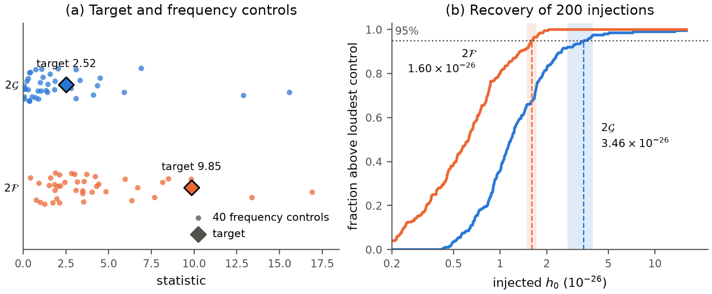

# Radio timing supports one orbital template for PSR J0437−4715 in LIGO O4a

Nathaniel Fairfield

## Abstract

Earlier work predicted that one orbital template would suffice for
PSR J0437−4715. We test that prediction at twice the pulsar's rotation
frequency using a modern radio timing solution and 246.1 days of LIGO O4a
data. Increasing the published orbital period by one standard
deviation (16 ms) costs 78% of the coherent power at the later MeerKAT
observing times and 71% at those of the Indian Pulsar Timing Array.
Increasing the rate of periastron advance along with the period preserves
the pulsar's orbital longitude and brings the loss below 0.008% in both
datasets. Across the orbits tested from the joint timing covariance, the
largest fractional power loss at the sampled detector times was
$3.73\times10^{-8}$, well below our 20% tolerance. The strain search
used the best-fit orbit throughout and found no significant excess. The strain amplitude for 95% recovery
of simulated signals above the loudest control was $3.46\times10^{-26}$
for a filter with one assumed linear polarization and $1.60\times10^{-26}$
when fitting both polarizations.

## 1. How accurately must we know the orbit?

A pulsar's motion around its companion changes the light-travel time to
Earth. A coherent search corrects for that delay before adding the signal
over many orbits. Each trial set of orbital parameters defines one template.
Using a Keplerian orbit and 1995 catalogue parameters, Dhurandhar &
Vecchio predicted that J0437 would need just one filter for a year at a
3% maximum mismatch. Their catalogue gave a 1.04-ms uncertainty on the
orbital period. The modern timing fit includes periastron advance and
gives a 16-ms period uncertainty ([Dhurandhar & Vecchio 2001, Tables I and III](#ref-dhurandhar2001),
[Reardon et al. 2024a](#ref-reardon2024a)).

The search of LIGO's third and fourth science runs (S3/S4) excluded J0437.
Varying the timing parameters within their individual errors gave a phase
drift above the $30^\circ$ cutoff. The authors cautioned that correlations
could make this estimate too large. The S5 search used timing covariances
and reported an upper limit for J0437. For binaries without a measured
correlation matrix, it assumed perfect correlation between the time and
longitude of periastron ([Abbott et al. 2007, §IV](#ref-abbott2007),
[Abbott et al. 2010, §§2.2–3 and Table 1](#ref-abbott2010)).

In O3, Vargas & Melatos searched J0437 over 60–500 Hz with a hidden
Markov model. They held the period and projected semimajor axis fixed.
A 55-s uncertainty in the time of passage through the ascending node led
them to search 6 to 49 trial times across the band
([Vargas & Melatos 2023, Tables I–II](#ref-vargas2023)). The
LIGO–Virgo–KAGRA (LVK) O4a targeted search held the radio timing
parameters fixed. The subsequent O4ab narrowband search excluded J0437 because of
orbital uncertainty ([LVK 2025](#ref-lvk2025), [LVK 2026a](#ref-lvk2026a)).
We test whether one orbit suffices at twice the rotation frequency
(347.376 Hz) over 246.1 days, allowing up to 20% loss of coherent power.

We refit 11,637 Parkes Pulsar Timing Array (PPTA) pulse arrival times with
TEMPO2, adopting the released observatory clocks and noise hyperparameters
([Zic et al. 2023](#ref-zic2023), [Reardon et al. 2023](#ref-reardon2023),
[2024a](#ref-reardon2024a), [2024b](#ref-reardon2024b)). The published fit
used the DE436 Solar System ephemeris in part (D. Reardon, personal
communication, October 2026). We use DE440 throughout ([Park et al. 2021](#ref-park2021)).

TEMPO2's QR solver fits the timing parameters and noise coefficients
together. We take the covariance of the ten binary parameters from this
joint fit, then convert the timing solution from barycentric coordinate
time to barycentric dynamical time for the search. The T2 binary model
includes periastron advance, secular changes in the orbit, Shapiro delay
and changes in viewing geometry ([Hobbs et al. 2006](#ref-hobbs2006),
[Edwards et al. 2006](#ref-edwards2006)).

## 2. Why one template suffices

J0437 has an eccentricity of only $1.9\times10^{-5}$. In a nearly circular
orbit the point of closest approach is hard to locate, even when the
pulsar's motion along the line of sight is well measured. To leading order
the light-travel delay is $x\sin\ell(t)$, where $x$ is the projected
semimajor axis in light-seconds and $\ell$ is the orbital longitude. For
orbital period $P_b$, periastron epoch $T_0$ and periastron longitude
$\omega_0$ at that epoch,

$$
\ell(t)\simeq\omega_0+\left(\frac{2\pi}{P_b}+\dot\omega\right)(t-T_0).
$$

A longer period gives nearly the same longitude history if periastron
advances faster. Similarly, a later periastron epoch can be offset by a
larger longitude at that epoch. To leading order the compensating changes are

$$
\delta\dot\omega\simeq\frac{2\pi}{P_b^2}\,\delta P_b,
\qquad
\delta\omega_0\simeq\frac{2\pi}{P_b}\,\delta T_0.
$$

The second relation keeps the time of passage through the ascending node
nearly fixed. In the published solution the one-standard-deviation errors
on $P_b$ and $T_0$ round to 16 ms and 17 s, respectively. Using the published precision,
each relation reproduces the published error on its partner to within 0.002%.
Hobbs et al. measured a correlation of 0.99999998 between $T_0$ and
$\omega_0$ in earlier J0437 data. Pitkin et al. assigned a correlation
of 0.9999 to each of these two pairs in a simulation. Our fit to J0437
gives 0.99999936 for $P_b$ and $\dot\omega$
([Hobbs et al. 2006, Table 9](#ref-hobbs2006),
[Pitkin et al. 2017, §4.1.1](#ref-pitkin2017)). For the power calculation
we retain the finite eccentricity and all ten binary parameters, including
the longitude of the ascending node.

### A test with later radio observations

The PPTA observations end more than a year before the strain data begin.
We use the published PPTA parameters and our DE440 refit to predict later
arrival times from MeerKAT and the Indian Pulsar Timing Array (InPTA).
We keep spin, astrometry and orbit fixed. We retain each release's
dispersion, frequency-dependent and instrumental corrections, some of
which were measured during O4a
([Miles et al. 2025](#ref-miles2025), [Rana et al. 2025](#ref-rana2025)).

An earlier study used the Crab pulsar's radio ephemeris to simulate
continuous waves and measure the loss of coherent power due to timing noise
([Ashton et al. 2015](#ref-ashton2015)). For J0437 we convert each measured
arrival-time residual $r$ to a gravitational-wave phase error
$2\pi f_{\rm GW}r$. We average the complex phases over frequency
channels within each observation file group, weighting by inverse timing
variance. We then give the $N$ groups equal weight. The fraction of coherent
power retained at the radio observing times is

$$
\mathcal C=\left|\frac{1}{N}\sum_{k=1}^{N}
\overline{\exp(2\pi i f_{\rm GW}r)}_k\right|^2.
$$

A constant phase offset leaves $\mathcal C$ unchanged. Table 1 gives the
loss, $1-\mathcal C$, for the official O4a dates (24 May 2023 to 16 January
2024). MeerKAT contributes seven observations in May–July and InPTA contributes
29 file groups on 20 days across the run. The published model gives
root-mean-square residuals of 154 ns at MeerKAT and 3.02 μs at InPTA.

*Table 1. Power lost at the radio observing times. The four shifts start from
the published PPTA parameters and use their quoted marginal errors.*

| Timing parameters | MeerKAT loss | InPTA loss |
|---|---:|---:|
| Published PPTA fit | 0.000015% | 0.0077% |
| DE440 refit used for the search | 0.000015% | 0.0077% |
| Each radio release's own fit, including O4a | 0.000014% | 0.0082% |
| Increase $P_b$ by $1\sigma$ | 78.1% | 71.4% |
| Also increase $\dot\omega$ as predicted above | 0.000015% | 0.0077% |
| Increase $T_0$ by $1\sigma$ | 85.6% | 77.2% |
| Also increase $\omega_0$ as predicted above | 0.000015% | 0.0077% |

Moving either the period or epoch alone costs most of the power. In both
datasets the predicted change in the second parameter restores coherence
to the precision shown. We chose the four shifts from the published
marginal errors and the longitude relations above, independently of our
refitted covariance.

Allowing a separate dispersion correction each day also preserves coherence.
In a separate fit to the 36 post-PPTA MeerKAT observations, we allow for
smooth spin and dispersion terms. The sine coefficient at the orbital
period, which measures an offset in projected semimajor axis, is
$+126\pm46$ ns. The cosine coefficient, which measures a longitude offset
in light-travel time, is $-66\pm46$ ns. Their robust standard errors are
61 and 55 ns, respectively ([MacKinnon & White 1985](#ref-mackinnon1985)).
InPTA gives a less precise longitude offset whose sign depends on the
weights. MeerKAT ends early in O4a, so its precision applies only to
those epochs. Under uniform orbital coverage a sinusoidal delay error
would need an amplitude of 0.30 ms to lose 20% of the power.

The Pulsar Portal supplies a later check using 543 arrival times from 17
MeerKAT Thousand Pulsar Array observations in O4b. With updated clocks and
the same spin and orbit, the sampled loss is 0.0014%
([Pulsar Portal](#ref-pulsarportal), [Johnston et al. 2020](#ref-johnston2020),
[Bailes et al. 2016](#ref-bailes2016), [2020](#ref-bailes2020)).

### Power loss over the strain observations

We propagate the joint timing errors to phase at the sampled detector times.
For this test we weight by squared template amplitude and inverse noise
variance per file, and remove a constant phase. We test 256 Gaussian draws
and all 1,024 corners of a box extending three standard deviations along
each principal axis of the phase metric in covariance-normalized coordinates.
The largest fractional loss in these tests is $3.73\times10^{-8}$
([Leaci & Prix 2015](#ref-leaci2015)).

An independent QR solve reproduces the orbital uncertainties, and PINT,
TEMPO2 and LALSuite agree on the binary delays ([Luo et al. 2021](#ref-luo2021),
[Wette 2020](#ref-wette2020)). Fits to the first and second halves of the
timing data, with all ten binary parameters free and noise hyperparameters
held fixed, also preserve coherence. When we withhold a year, however, the
whitened residuals have 24% more root-mean-square scatter than predicted.
Most of the excess lies outside the patterns produced by small changes in
the ten binary parameters. The formal orbital uncertainties remain
conditional on the timing and noise model.

### Comparison with the narrowband selection rule

The O4ab narrowband search excluded four binaries, including J0437, and
reported a range of 1 to 90 days for their maximum coherent spans. It
gave no separate value for J0437 ([LVK 2026a, §4.1](#ref-lvk2026a)).
The selection rule adds the signed changes in Doppler frequency produced
by the quoted orbital errors. For a nearly circular orbit the epoch and
longitude terms enter with opposite signs. They nearly cancel for the
published J0437 errors, since $\sigma_{\omega_0}\simeq 2\pi\sigma_{T_0}/P_b$.
The rule omits secular derivatives, so it misses the cancellation between
period and periastron advance in this system
([Mirasola et al. 2024, eqs. 23–25 and Appendix A](#ref-mirasola2024)).

That rule requires the frequency error to stay within half a Fourier bin.
For a phase error $\delta\phi=A\sin(2\pi t/P_b)$, the peak frequency error
is $A/P_b$, so the rule limits the duration to $T\leq P_b/(2A)$. Under
uniform coverage over many orbits, however, the retained power approaches
$J_0(A)^2$, where $J_0$ is the Bessel function of order zero. A longer
observation narrows the Fourier bin even when the phase error repeats each
orbit and the power loss stays small.

## 3. Search of LIGO O4a data

We search the Hanford and Livingston strain for a signal whose phase
follows twice the radio rotational phase up to a constant offset. We use
one set of orbital parameters throughout. The GWOSC release includes data
before the official start of O4a. Our 102 files span 15 May 2023 to
16 January 2024, or 246.1 elapsed days including gaps
([LVK 2026b](#ref-lvk2026b), [GWOSC O4a release](https://gwosc.org/O4/O4a/)).

CWInPy 1.5.0 reduces the strain to 26.37 million one-second complex
samples using DE440 barycentering and a 0.25-Hz low-pass filter. We apply
the full phase difference between the ELL1 model used for the original
heterodyne and the T2 model used for the search. We checked this step
using six minutes of synthetic 4096-Hz strain for each detector. Rephasing
the reduced strain and using T2 directly gave complex time series whose
fractional root-mean-square difference over the central three minutes was below $2\times10^{-8}$.

CWInPy filters in 3,600-s blocks. A transient near the end of a block
can reach thousands of times the usual noise power. We discard the last
60 s of each block (3.1% of samples) and segments with fewer than 300
samples left (0.06%). Within each remaining segment we estimate
the noise variance $\sigma^2(t)$ from a 301-s running median of sample power
divided by $\ln 2$. We remove samples above 20 times this variance and the
2 s on either side (0.25%). This leaves 25.48 million samples across both
detectors ([Pitkin 2022](#ref-pitkin2022)).

We used the measured sample powers to estimate the signal-to-noise ratio
for a constant-amplitude signal. Trimming the block ends and recomputing
one variance per file improved this estimate by a factor of 3.75 relative
to the untrimmed files. The full weighting procedure gave a factor of 5.89.

### Detection statistics

Both statistics use the same orbit. To measure the cost of assuming
one polarization, we use a reference filter with $\cos\iota=0$ and
$\psi=0$. These angles give a single linearly polarized detector response
$m_1$ for unit strain amplitude. The timing fit gives an orbital inclination
of $137.51^\circ$ and a position angle of $208.04^\circ$ for the ascending
node. These angles could be used to choose a polarization model if spin
and orbit are aligned. A radio and $\gamma$-ray emission model gives a viewing
angle of $136\pm5^\circ$ ([Pétri et al. 2026](#ref-petri2026)).

We fit the reference response's amplitude and initial phase with the
matched-filter statistic

$$
2\mathcal G=\frac{2|\langle m_1,d\rangle_w|^2}{\langle m_1,m_1\rangle_w},
\qquad
\langle a,b\rangle_w=\sum_t w(t)\,a(t)^*b(t).
$$

Here $d$ is the complex strain and the sum includes both detectors.
The weight is $w(t)=B\Delta t/\sigma^2(t)$, with $\Delta t=1$ s and
equivalent noise bandwidth $B=0.446$ Hz for the filter and one-second
averaging. In Gaussian noise the reference distribution of $2\mathcal G$
is $\chi^2$ with two degrees of freedom
([Jaranowski & Królak 2010](#ref-jaranowski2010)).

To allow for an unknown spin inclination and polarization angle, we also
compute the $\mathcal F$-statistic. A second response $m_2$ uses
$\psi=\pi/4$ and the same phase history as $m_1$. Fitting a complex
coefficient for each response fits all four amplitude parameters. With
$Y_k=\langle m_k,d\rangle_w$ and $M_{kl}=\langle m_k,m_l\rangle_w$,

$$
2\mathcal F=2\,Y^\dagger M^{-1}Y.
$$

The Gaussian-noise reference distribution has four degrees of freedom
([Jaranowski et al. 1998](#ref-jaranowski1998)).

### Results

We compare the target with 40 frequencies chosen in advance within
±0.20 Hz, excluding the central ±0.03 Hz and known instrumental lines.
We correct each control for the filter response. The comparison assumes
similar noise across the band. In a separate scan of 7.2 million bins,
$2\mathcal G$ averages 2.04, close to the expected value of 2, and 1.08%
of bins exceed the Gaussian 99th percentile.

Neither statistic shows a significant excess at J0437 (Table 2). To measure
sensitivity we inject 200 simulated signals into the reduced data, after
filtering and noise estimation. We use the same waveform code for injection
and recovery. We draw orbits from the fitted covariance, inclinations
from an isotropic distribution, and polarization angles and initial phases
uniformly. We search each signal at the best-fit orbit and count a recovery when the statistic exceeds its
loudest control. We did not perform an end-to-end recovery of a hardware
injection.

*Table 2. Search results at 347.376 Hz. The Gaussian tail probability refers
to the target alone. Each strain amplitude gives 95% recovery of injections
above the loudest of the 40 controls for that filter.*

| Quantity | $2\mathcal G$ | $2\mathcal F$ |
|---|---:|---:|
| Target statistic | 2.52 | 9.85 |
| Gaussian tail probability | 0.28 | 0.043 |
| Controls at or above target (out of 40) | 11 | 2 |
| Mean control statistic | 2.28 | 4.07 |
| Loudest control | 15.58 | 16.89 |
| Strain amplitude for 95% recovery | $3.46\times10^{-26}$ | $1.60\times10^{-26}$ |
| Conditional 90% bootstrap interval | $(2.73,3.98)\times10^{-26}$ | $(1.49,1.72)\times10^{-26}$ |

The statistic is quadratic in injected amplitude. We solve for each signal’s
threshold crossing and report the 95th percentile of those amplitudes. The
intervals come from 20,000 bootstrap resamplings of the injections, using
recovery curves on a 49-point amplitude grid.
They describe sampling uncertainty for this population at fixed data,
calibration and thresholds.

The reference filter captures a median 48% of the signal power recovered by
the $\mathcal F$-statistic, falling to 16% at the fifth percentile. Using
the best-fit orbit for every injection costs the $\mathcal F$-statistic at
most $3.7\times10^{-9}$ of the injected power.

The amplitudes in Table 2 measure sensitivity at the loudest-control
threshold. The loudest $2\mathcal G$ control was 15.58. Under independent Gaussian
noise, the probability that at least one of 40 controls reaches that value
is 1.6%. For $2\mathcal F$, using the observed target statistic as the
recovery threshold lowers the 95%-recovery amplitude from
$1.60\times10^{-26}$ to $1.20\times10^{-26}$. For comparison, the
LVK search of the same O4a data set 95% upper limits on J0437 of
$(7.2,9.0,5.8)\times10^{-27}$ with the Bayesian, $\mathcal F$-statistic
and 5n-vector methods, respectively ([LVK 2025](#ref-lvk2025)).

*Figure 1. Both statistics use the best-fit orbit. Diamonds mark the
target and dots mark the 40 control frequencies (left). Recovery curves
give the fraction of 200 injections above each statistic's loudest control
(right). Dashed lines mark 95% recovery and shading gives the conditional
90% intervals.*

## 4. Conclusion

At the later MeerKAT and InPTA observing times, a 16-ms increase in
J0437's orbital period costs most of the coherent power when applied
alone. The predicted change in periastron advance restores coherence in
both datasets. Propagating the joint timing errors to the detector times
supports using one orbital template for the 246.1-day O4a search. The
same test of coherent power could be used to reassess J0437 for a
narrowband search through O4b, over a range of frequencies and spin-down
rates.

## Data and reproducibility

The radio arrival times and raw strain are available from the cited releases.
The [gravid repository](https://github.com/thandal/gravid) contains the
timing models, scripts and numerical summaries. Under `scripts/timing/`,
`later_radio_observations/` reproduces Table 1 without the fitted
covariance. The orbital-delay calculations, fits to later observations
and split-data tests are in `binary_model/`, `orbital_offset_fit/`
and `supporting_checks/`, respectively.

The recorded search outputs are in `results/j0437_search/`.
The inputs, weights and injected sources are documented with the run.
Under `scripts/search/noise_weights/`, `summarize.py`
reproduces Table 2 from the saved filter outputs. For the reference filter,
the original `result.json` gives $3.59\times10^{-26}$ by interpolating on
a 16-point amplitude grid. Table 2 uses the individual threshold crossings.
The reduced strain is in a [public folder](https://drive.google.com/drive/folders/1GZsjyQHLniwpRwuOSjeJ_90WFVWtmRWF);
the repository gives its checksum. The bulk validation outputs are not public.

## Acknowledgments

We thank Daniel Reardon for clarifying the Solar-system ephemeris used in
the released timing analysis.

We acknowledge the [Pulsar Portal](https://pulsars.org.au/) for distributing
the additional MeerTime timing products, and cite its publication as
[Bailes et al. (2026), in preparation](#ref-bailes2026portal), following the
portal's [data-use policy](https://pulsars.org.au/data-usage/). Portal downloads
and their processing provenance are archived with checksums in the analysis.

This research has made use of data or software obtained from the
Gravitational Wave Open Science Center (gwosc.org), a service of the LIGO
Scientific Collaboration, the Virgo Collaboration, and KAGRA. This material
is based upon work supported by NSF's LIGO Laboratory which is a major
facility fully funded by the National Science Foundation, as well as the
Science and Technology Facilities Council (STFC) of the United Kingdom, the
Max-Planck-Society (MPS), and the State of Niedersachsen/Germany for support
of the construction of Advanced LIGO and construction and operation of the
GEO600 detector. Additional support for Advanced LIGO was provided by the
Australian Research Council. Virgo is funded, through the European
Gravitational Observatory (EGO), by the French Centre National de Recherche
Scientifique (CNRS), the Italian Istituto Nazionale di Fisica Nucleare (INFN)
and the Dutch Nikhef, with contributions by institutions from Belgium,
Germany, Greece, Hungary, Ireland, Japan, Monaco, Poland, Portugal, Spain.
KAGRA is supported by Ministry of Education, Culture, Sports, Science and
Technology (MEXT), Japan Society for the Promotion of Science (JSPS) in
Japan; National Research Foundation (NRF) and Ministry of Science and ICT
(MSIT) in Korea; Academia Sinica (AS) and National Science and Technology
Council (NSTC) in Taiwan.

## References

Abbott, B., et al. (2007). [Upper limits on gravitational wave emission from 78 radio pulsars](https://doi.org/10.1103/PhysRevD.76.042001). *Physical Review D*, **76**, 042001.

Abbott, B. P., et al. (2010). [Searches for gravitational waves from known pulsars with science run 5 LIGO data](https://doi.org/10.1088/0004-637X/713/1/671). *The Astrophysical Journal*, **713**, 671–685.

Ashton, G., Jones, D. I., and Prix, R. (2015). [Effect of timing noise on targeted and narrow-band coherent searches for continuous gravitational waves from pulsars](https://doi.org/10.1103/PhysRevD.91.062009). *Physical Review D*, **91**, 062009.

Bailes, M.; et al. (2016). [MeerTime—the MeerKAT Key Science Program on Pulsar Timing](https://pos.sissa.it/277/011/pdf). *Proceedings of Science*, MeerKAT2016, 011.

Bailes, M.; et al. (2020). [The MeerKAT Telescope as a Pulsar Facility: System verification and early science results from MeerTime](https://doi.org/10.1017/pasa.2020.19). *Publications of the Astronomical Society of Australia*, **37**, e028.

Bailes, M.; et al. (2026). Publication describing the Pulsar Portal, in preparation, as listed in the [portal data-use policy](https://pulsars.org.au/data-usage/) on 17 October 2026. Title and publication identifiers not supplied.

Johnston, S.; et al. (2020). [The Thousand-Pulsar-Array programme on MeerKAT—I. Science objectives and first results](https://doi.org/10.1093/mnras/staa516). *Monthly Notices of the Royal Astronomical Society*, **493**, 3608–3615.

The Pulsar Portal (2026). [MeerTime pulsar timing data](https://pulsars.org.au/). Evolving data service; J0437−4715 TOAs downloaded 16 October 2026. Archive checksum and member provenance: `results/timing/portal_arrival_times/download_results.json` and `inventory.json`.

Dhurandhar, S. V.; Vecchio, A. (2001). [Searching for continuous gravitational wave sources in binary systems](https://doi.org/10.1103/PhysRevD.63.122001). *Physical Review D*, **63**, 122001.

Edwards, R. T.; Hobbs, G. B.; Manchester, R. N. (2006). [TEMPO2, a new pulsar timing package - II. The timing model and precision estimates](https://doi.org/10.1111/j.1365-2966.2006.10870.x). *Monthly Notices of the Royal Astronomical Society*, **372**, 1549–1574.

Hobbs, G. B.; Edwards, R. T.; Manchester, R. N. (2006). [tempo2, a new pulsar-timing package - I. An overview](https://doi.org/10.1111/j.1365-2966.2006.10302.x). *Monthly Notices of the Royal Astronomical Society*, **369**, 655–672.

Jaranowski, P.; Królak, A.; Schutz, B. F. (1998). [Data analysis of gravitational-wave signals from spinning neutron stars: The signal and its detection](https://doi.org/10.1103/PhysRevD.58.063001). *Physical Review D*, **58**, 063001.

Jaranowski, P.; Królak, A. (2010). [Searching for gravitational waves from known pulsars using the $\mathcal F$ and $\mathcal G$ statistics](https://doi.org/10.1088/0264-9381/27/19/194015). *Classical and Quantum Gravity*, **27**, 194015.

Leaci, P.; Prix, R. (2015). [Directed searches for continuous gravitational waves from binary systems: Parameter-space metrics and optimal Scorpius X-1 sensitivity](https://doi.org/10.1103/PhysRevD.91.102003). *Physical Review D*, **91**, 102003.

LIGO Scientific Collaboration, Virgo Collaboration, and KAGRA Collaboration (LVK) (2025). [Search for Continuous Gravitational Waves from Known Pulsars in the First Part of the Fourth LIGO-Virgo-KAGRA Observing Run](https://doi.org/10.3847/1538-4357/adb3a0). *The Astrophysical Journal*, **983**, 99.

LIGO Scientific Collaboration, Virgo Collaboration, and KAGRA Collaboration (LVK) (2026a). [Narrowband Searches for Continuous Gravitational Waves from known Pulsars in the First Two Parts of the Fourth LIGO–Virgo–KAGRA Observing Run](https://doi.org/10.3847/1538-4357/ae77fc). *The Astrophysical Journal*, **1005**, 221.

LIGO Scientific Collaboration, Virgo Collaboration, and KAGRA Collaboration (LVK) (2026b). [Open Data from LIGO, Virgo, and KAGRA through the First Part of the Fourth Observing Run](https://doi.org/10.3847/1538-4357/ae211e). *The Astrophysical Journal*, **1004**, 232.

Luo, J.; Ransom, S.; Demorest, P.; et al. (2021). [PINT: A Modern Software Package for Pulsar Timing](https://doi.org/10.3847/1538-4357/abe62f). *The Astrophysical Journal*, **911**, 45.

MacKinnon, J. G.; White, H. (1985). [Some heteroskedasticity-consistent covariance matrix estimators with improved finite sample properties](https://doi.org/10.1016/0304-4076(85)90158-7). *Journal of Econometrics*, **29**, 305–325.

Mirasola, L.; Leaci, P.; Astone, P.; et al. (2024). [New semicoherent targeted search for continuous gravitational waves from pulsars in binary systems](https://doi.org/10.1103/PhysRevD.110.123043). *Physical Review D*, **110**, 123043.

Miles, M. T.; Shannon, R. M.; Reardon, D. J.; et al. (2025). [The MeerKAT Pulsar Timing Array: the 4.5-yr data release and the noise and stochastic signals of the millisecond pulsar population](https://doi.org/10.1093/mnras/stae2572). *Monthly Notices of the Royal Astronomical Society*, **536**, 1467–1488.

Park, R. S.; Folkner, W. M.; Williams, J. G.; et al. (2021). [The JPL Planetary and Lunar Ephemerides DE440 and DE441](https://doi.org/10.3847/1538-3881/abd414). *The Astronomical Journal*, **161**, 105.

Pétri, J.; Stammler, P.; Guillemot, L.; et al. (2026). [Multi-wavelength emission modelling of PSR J0437−4715](https://doi.org/10.1051/0004-6361/202558077). *Astronomy & Astrophysics*, **708**, A328.

Pitkin, M.; Isi, M.; Veitch, J.; and Woan, G. (2017). [A nested sampling code for targeted searches for continuous gravitational waves from pulsars](https://arxiv.org/abs/1705.08978). arXiv:1705.08978.

Pitkin, M. (2022). [CWInPy: A Python package for inference with continuous gravitational-wave signals from pulsars](https://doi.org/10.21105/joss.04568). *Journal of Open Source Software*, **7**, 4568.

Rana, P.; Tarafdar, P.; Nobleson, K.; et al. (2025). [The Indian Pulsar Timing Array data release 2: I. Dataset and timing analysis](https://doi.org/10.1017/pasa.2025.10066). *Publications of the Astronomical Society of Australia*, **42**, e108.

Reardon, D. J.; Zic, A.; Shannon, R. M.; et al. (2023). [The Gravitational-wave Background Null Hypothesis: Characterizing Noise in Millisecond Pulsar Arrival Times with the Parkes Pulsar Timing Array](https://doi.org/10.3847/2041-8213/acdd03). *The Astrophysical Journal Letters*, **951**, L7.

Reardon, D. J.; Bailes, M.; Shannon, R. M.; et al. (2024a). [The Neutron Star Mass, Distance, and Inclination from Precision Timing of the Brilliant Millisecond Pulsar J0437-4715](https://doi.org/10.3847/2041-8213/ad614a). *The Astrophysical Journal Letters*, **971**, L18.

Reardon, D. J.; Bailes, M.; Shannon, R.; et al. (2024b). [Parkes Pulsar Timing Array data sets for PSR J0437-4715](https://doi.org/10.25919/20rx-5f63). CSIRO Data Access Portal, data collection.

Vargas, A. F.; Melatos, A. (2023). [Search for continuous gravitational waves from PSR J0437−4715 with a hidden Markov model in O3 LIGO data](https://doi.org/10.1103/PhysRevD.107.064062). *Physical Review D*, **107**, 064062.

Wette, K. (2020). [SWIGLAL: Python and Octave interfaces to the LALSuite gravitational-wave data analysis libraries](https://doi.org/10.1016/j.softx.2020.100634). *SoftwareX*, **12**, 100634.

Zic, A.; Reardon, D. J.; Kapur, A.; et al. (2023). [The Parkes Pulsar Timing Array third data release](https://doi.org/10.1017/pasa.2023.36). *Publications of the Astronomical Society of Australia*, **40**, e049.
